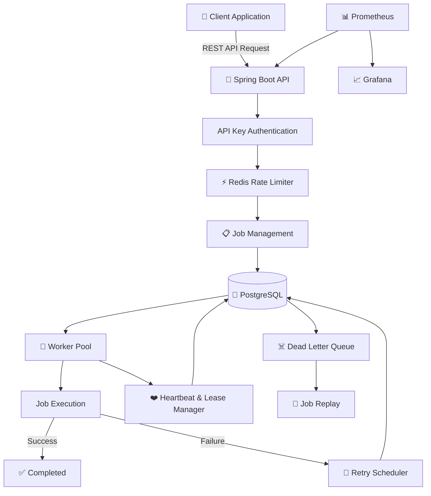
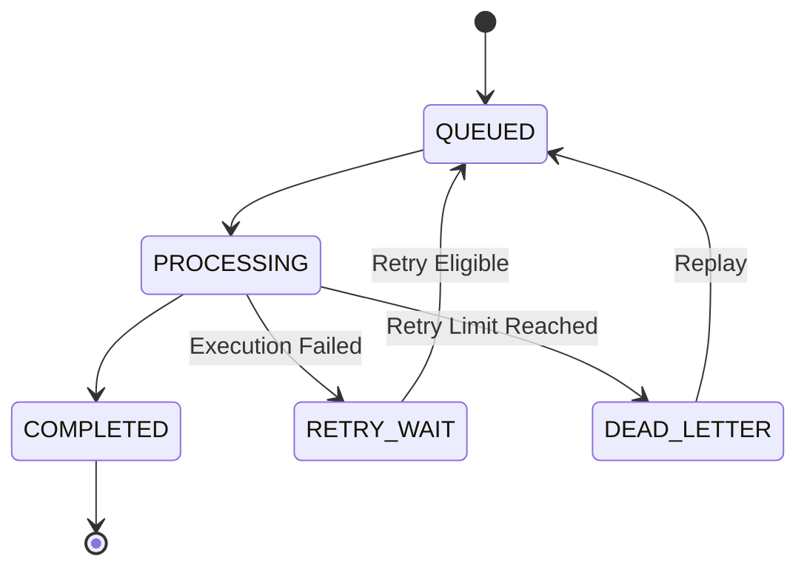

 <div align="center">


[](https://git.io/typing-svg)


### 🚀 [GitHub Repository](https://github.com/Adarsh705875/QueueForge)

</div>

> ⚠️ **Disclaimer:** QueueForge is an independent software engineering project demonstrating distributed background job processing concepts. It is a development and production-oriented candidate, not a certified production service. Deployment security, infrastructure configuration, load testing, and operational validation are required before using it for critical workloads.

---

## 📸 Preview

<!-- Add screenshots of your monitoring dashboard, API tests and Docker services here -->

---

## 📖 Overview

**QueueForge** is a distributed background job processing system built using **Java 21, Spring Boot, PostgreSQL and Redis**.

It provides a backend infrastructure for applications that need to execute time-consuming tasks asynchronously instead of blocking the main application request.

For example, an application might need to send emails, process uploaded files, generate reports, execute scheduled operations, or perform other background tasks.

Instead of executing these tasks directly during an API request, the application submits a job to QueueForge. The job is stored in PostgreSQL and processed asynchronously by available workers.

QueueForge focuses on reliability, concurrent execution, job recovery, controlled retries and distributed coordination.

**Core workflow:**

1. An application submits a background job through the REST API.
2. QueueForge validates and authenticates the request.
3. The job is stored persistently in PostgreSQL.
4. Available workers claim eligible jobs.
5. Workers execute jobs concurrently.
6. Failed jobs can be retried according to configured policies.
7. Leases and heartbeats help detect workers that stop responding.
8. Monitoring components expose application metrics.

**Example use cases:**

- Sending emails and notifications
- Processing uploaded files
- Generating reports
- Running scheduled tasks
- Executing data-processing jobs
- Handling asynchronous application workflows

---

## ✨ Features

| | Feature | Details |
|---|---|---|
| ⚙️ | **Background Job Processing** | Submit and execute jobs asynchronously through a REST API |
| 🧵 | **Concurrent Workers** | Multiple workers process eligible jobs using configurable concurrency |
| 🗄️ | **Persistent Job Storage** | PostgreSQL stores job state and execution information |
| 🔁 | **Automatic Retries** | Failed jobs can be retried with exponential backoff and jitter |
| ⏱️ | **Delayed Jobs** | Schedule jobs for execution at a future time |
| 🚦 | **Priority Queue** | Assign priorities to jobs to influence processing order |
| 🔐 | **API Key Authentication** | Protect API access using configured API credentials |
| ♻️ | **Idempotency** | Idempotency keys and request hashes help prevent duplicate submissions |
| ❤️ | **Worker Heartbeats** | Workers periodically report that they are still active |
| 🔒 | **Job Leases** | Temporary ownership of jobs helps coordinate concurrent workers |
| 🛡️ | **Fencing Tokens** | Lease versions help prevent stale workers from updating reclaimed jobs |
| 🚨 | **Crash Recovery** | Expired processing leases can be detected and jobs recovered |
| ☠️ | **Dead Letter Queue** | Jobs that exhaust their retry policy can be moved to a dead-letter state |
| 🔄 | **DLQ Replay** | Supports replaying dead-letter jobs |
| ⚡ | **Redis Rate Limiting** | Redis-backed token-bucket rate limiting using Lua |
| 📊 | **Prometheus Metrics** | Exposes metrics for application monitoring |
| 📈 | **Grafana Dashboards** | Provides a dashboard environment for observing system metrics |
| 🐳 | **Docker Compose** | Runs the application and supporting infrastructure as containers |
| 🧪 | **Automated Tests** | Maven-based automated test suite |
| 🔄 | **GitHub Actions CI** | Automatically builds and tests the project on GitHub |

---

## 🏗️ System Architecture



### How it works

**1. Job Submission**

A client application sends a job request to the QueueForge REST API. The application validates the request, applies authentication and rate-limiting rules, and stores the job.

**2. Job Persistence**

PostgreSQL acts as the durable job store. Job information includes execution status, attempts, priority, scheduling information, error details and worker lease information.

**3. Worker Execution**

The worker pool continuously looks for eligible jobs. Workers claim jobs and execute them independently, allowing multiple jobs to run concurrently.

**4. Retry Management**

When a job fails, the retry policy determines whether it can be executed again. Exponential backoff and jitter help avoid repeated retry spikes.

**5. Lease and Heartbeat Management**

A worker receives temporary ownership of a job. Heartbeats help maintain that ownership. If the worker disappears and the lease expires, the system can recover the job for another execution attempt.

**6. Dead Letter Queue**

Jobs that exceed their configured retry limit can be moved to a dead-letter state. These jobs can be inspected and replayed when appropriate.

**7. Monitoring**

Prometheus collects application metrics, while Grafana provides a dashboard environment to visualize system behavior.

---

## 🧰 Tech Stack

| Layer | Technology | Purpose |
|---|---|---|
| Language | Java 21 | Main application language |
| Backend Framework | Spring Boot 4.1.2 | Application framework |
| Web Layer | Spring MVC | REST API |
| Persistence | Spring Data JPA | Database interaction |
| Database | PostgreSQL 16 | Durable job storage |
| Database Migration | Flyway | Versioned database schema migrations |
| Cache / Coordination | Redis 7 | Rate limiting and fast coordination |
| Rate Limiting | Redis Lua | Atomic token-bucket operations |
| Security | Spring Security | API authentication |
| Validation | Jakarta Validation | Request validation |
| Monitoring | Spring Boot Actuator | Health and application metrics |
| Metrics | Micrometer + Prometheus | Metrics collection |
| Dashboards | Grafana | Monitoring visualization |
| Build Tool | Maven | Dependency and build management |
| Testing | JUnit, Mockito, H2 | Automated tests |
| Containerization | Docker | Application packaging |
| Orchestration | Docker Compose | Local multi-service deployment |
| CI | GitHub Actions | Automated build and test workflow |

---

## 📁 Project Structure

```text
QueueForge/
│
├── .github/
│   └── workflows/
│       └── ci.yml                 # GitHub Actions CI workflow
│
├── docs/                          # Project documentation
│
├── load-tests/                    # Load-testing resources
│
├── monitoring/
│   ├── prometheus/                 # Prometheus configuration
│   └── grafana/                    # Grafana provisioning and dashboards
│
├── scripts/
│   ├── check-env.sh                # Environment configuration validation
│   ├── backup.sh                   # Database backup utility
│   └── restore.sh                  # Database restore utility
│
├── src/
│   ├── main/
│   │   ├── java/
│   │   │   └── com/queueforge/     # Application source code
│   │   └── resources/
│   │       ├── db/
│   │       │   └── migration/      # Flyway SQL migrations
│   │       ├── application.properties
│   │       └── application-prod.properties
│   │
│   └── test/
│       ├── java/                   # Automated tests
│       └── resources/              # Test configuration
│
├── .dockerignore                   # Docker build exclusions
├── .env.example                    # Environment variable template
├── .gitignore                      # Git exclusions
├── compose.yaml                    # Multi-container configuration
├── Dockerfile                      # Application container build
├── HELP.md                         # Spring Boot project help
├── mvnw                            # Maven wrapper (Unix/macOS)
├── mvnw.cmd                        # Maven wrapper (Windows)
├── pom.xml                         # Maven dependencies and build config
└── README.md                       # Project documentation
```

**Important:** The tree shows the project organization and key paths. Generated files, Maven build output (`target/`), and local environment files are intentionally not part of the source-code structure.

---

## 🔄 Job Lifecycle

A job moves through different execution states during its lifecycle.



| State | Description |
|---|---|
| `QUEUED` | Job is waiting to be processed |
| `PROCESSING` | A worker has claimed the job |
| `RETRY_WAIT` | Job is waiting for its next retry |
| `COMPLETED` | Job execution succeeded |
| `DEAD_LETTER` | Job exhausted its retry policy |

The exact state transitions depend on the configured retry and recovery policies.

---

## 🛡️ Reliability and Distributed Processing

### 1. Retry Mechanism

When a job execution fails, QueueForge can retry it based on its configured retry policy.

The retry delay follows an exponential backoff strategy with jitter.

```text
Retry 1 → Short delay
Retry 2 → Longer delay
Retry 3 → Longer delay
Retry N → Maximum configured retry delay
```

Jitter helps reduce synchronized retry spikes when multiple jobs fail around the same time.

### 2. Worker Leases

Workers claim jobs using temporary leases.

A lease records which worker currently owns a job and when that ownership expires.

This helps the system identify jobs that may have been abandoned because a worker crashed or stopped responding.

### 3. Heartbeats

Workers periodically update their heartbeat information to indicate that they are still active.

If a heartbeat stops and the lease expires, the recovery mechanism can make the job eligible for processing again.

### 4. Fencing Tokens

Lease versions provide a mechanism for distinguishing newer job ownership from stale ownership.

This helps protect job state from updates made by workers whose leases are no longer valid.

### 5. Idempotency

Idempotency keys and request hashes help identify duplicate submissions.

This is especially useful when clients retry requests because of network failures or uncertain responses.

### 6. Dead Letter Queue

Jobs that cannot complete after their retry attempts can be moved to the dead-letter queue.

This separates repeatedly failing jobs from normal processing and provides a mechanism for inspection and replay.

> **Note:** Retrying a job can result in the underlying task executing more than once. External side effects should use idempotent operations or their own deduplication mechanisms.

---

## ⚙️ Configuration

QueueForge uses environment variables to configure infrastructure, security, worker execution and rate limiting.

Create a
